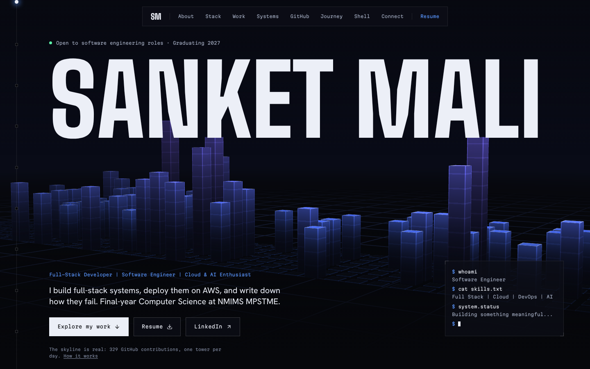
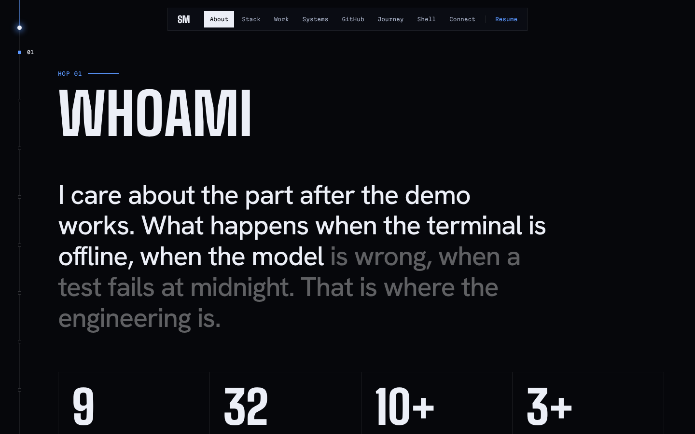
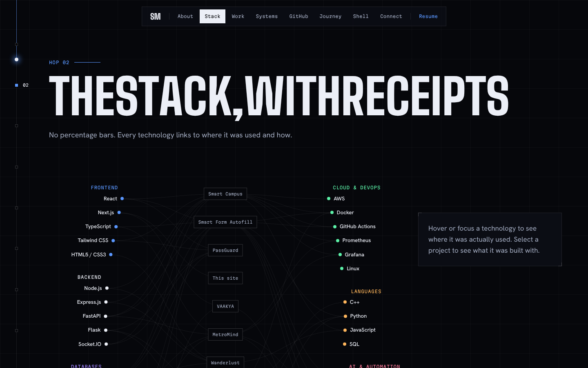
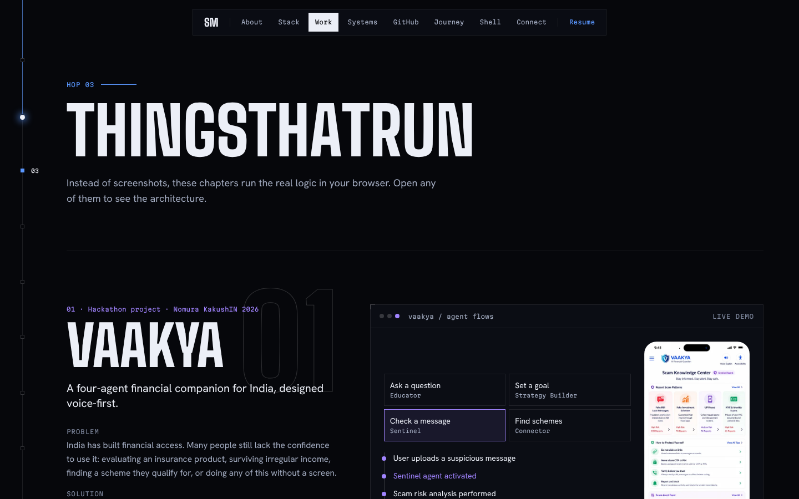
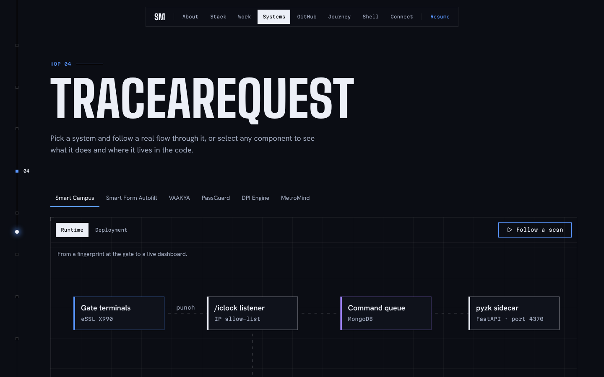
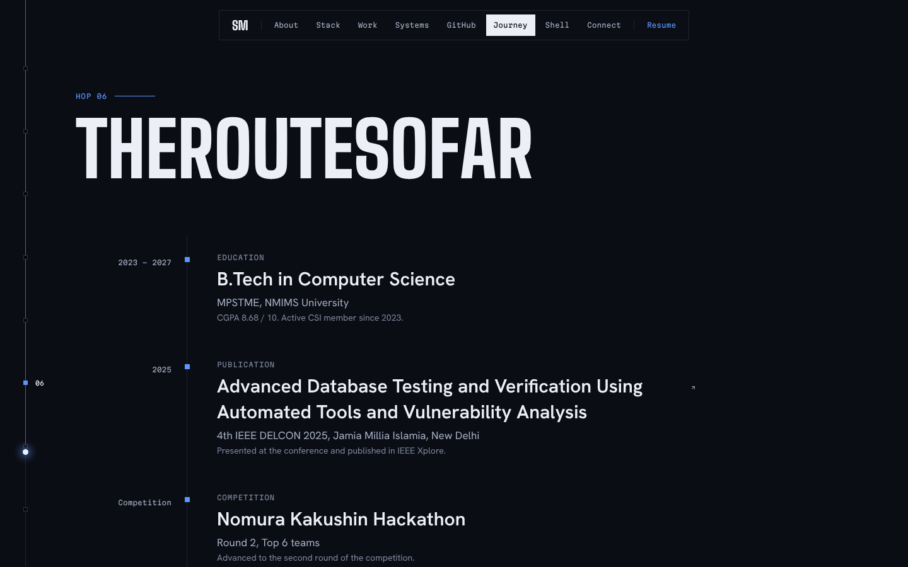
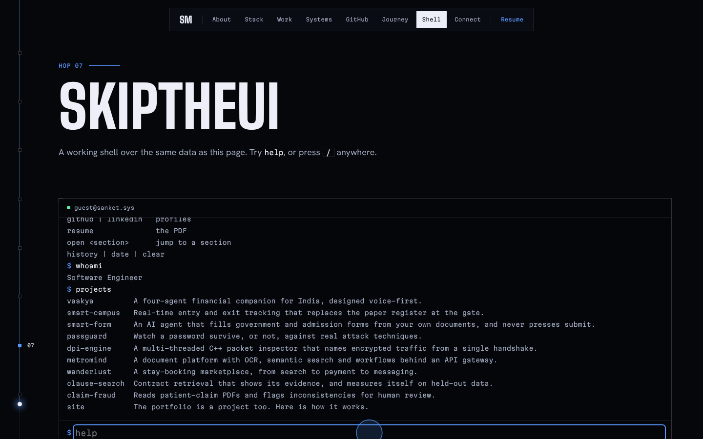
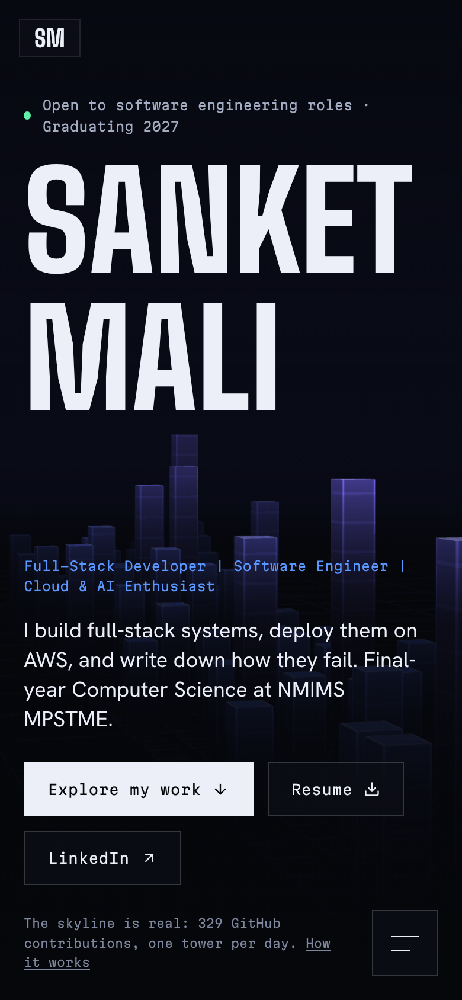

<div align="center">

# Sanket Mali — Portfolio

**Live site:** [portfolio-eues.onrender.com](https://portfolio-eues.onrender.com/)




</div>

A personal portfolio built as an interactive system rather than a page of screenshots. The hero skyline is drawn with hand-written WebGL2 — **one tower per day of real GitHub contributions** — and the project chapters run real logic in the browser.

## Screenshots

| About (`whoami`) | Stack, with receipts |
|:---:|:---:|
|  |  |
| **Things that run (project chapters)** | **Trace a request** |
|  |  |
| **Journey** | **Built-in shell** |
|  |  |

<p align="center">
  <br/>
  <sub>Mobile</sub>
</p>

## Features

- **GitHub skyline** — WebGL2 3D city where each tower is one day of contributions, with a still-frame fallback for software renderers and reduced motion
- **Stack with receipts** — hover any technology to see exactly which project used it
- **Project chapters** — live demos instead of static images, plus case studies at `/work/[slug]`
- **Trace a request** — follow a real request through a system's architecture, component by component
- **Shell** — a working terminal over the same data as the page (`help`, `whoami`, `projects`, history, `/` shortcut)
- **Motion layer** — split-text headings, spotlight hover, marquee ticker, all with reduced-motion fallbacks
- **Fast and accessible** — Lighthouse 100/100/100/100 on desktop, CLS 0
- Resume at `/resume`, OG image, sitemap and robots

## Tech stack

Next.js 16 (static export) · React 19 · TypeScript · Tailwind CSS 4 · Motion · WebGL2 · lucide-react · deployed on Render

## Getting started

```bash
npm install
npm run dev                       # http://localhost:3000
npm run build && npm run preview  # static export served from out/
npm run e2e                       # functional tests against the preview build
```

| File | Purpose |
|---|---|
| `data/profile.ts`, `data/projects.ts` | All content — the site, the shell and the skyline read from them |
| `lib/site.ts` | Links and the availability line |
| `npm run snapshot` | Refreshes `data/github-snapshot.json`, the fallback used when GitHub is unreachable |
| `.env.example` | Optional settings (site URL, GitHub token, Resend key). The site works with none of them |
| `BUILD_PROGRESS.md` | Plan, findings and open questions |

## Deployment

Live on Render as a static site, built from `render.yaml` (`npm ci && npm run build`, publish `out/`). It also deploys to any static host such as Vercel or Netlify. Set `NEXT_PUBLIC_SITE_URL` to the final domain.

## Author

**Sanket Mali** · [GitHub](https://github.com/Sanket1516)
